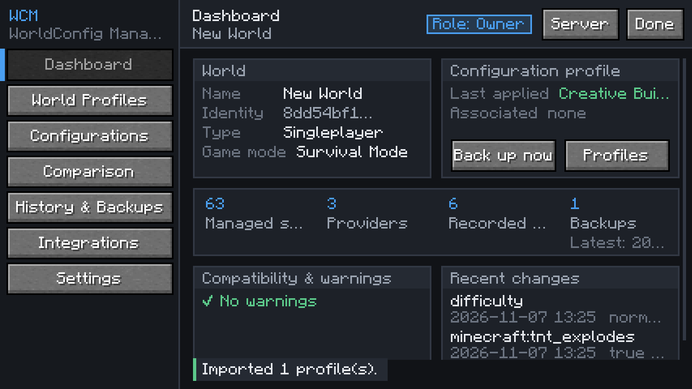

# WorldConfig Manager (WCM)

*Every Minecraft world deserves its own configuration.*

WorldConfig Manager is a Fabric mod for **Minecraft Java Edition 26.3** that manages world-specific configuration
from one in-game control centre: configuration profiles, vanilla game rules and other settings, previews,
automatic backups, history with undo, side-by-side comparison, `.wcmp` import/export, and a public API that lets other
mods plug in their settings. It works in singleplayer and on dedicated servers, with server-side permission checks.



## Features (implemented and verified in game)

* **Dashboard** with live world identity, type and game mode, applied/associated profile, counts, warnings and recent
  changes.
* **World profiles**: create (empty or from the current configuration), rename, edit description/tags, duplicate,
  delete, associate with a world, default profile (optionally auto-applied to new worlds), preview, apply, compare,
  export, import. Five starter profiles.
* **Configuration browser**: search, category/provider/modified filters, typed editors with live validation, reset to
  default, staged changes, preview, transactional apply.
* **Vanilla integration**: all game rules discovered at runtime from the game (59 in 26.3) plus world difficulty
  (respecting hardcore and difficulty lock); client video/control options (FOV, render/simulation distance,
  brightness, …) as local client profiles.
* **Safety**: validation before any change, a backup before every change, automatic rollback on failure (rollback
  failures reported explicitly), atomic file writes, unreadable files quarantined, never deleted.
* **History** of every change (who, what, old → new, result) with filters, retention and "restore state before this
  change".
* **Backups**: automatic and manual, list, preview restore, restore, compare, export, delete, retention policy.
* **Comparison** of profiles, backups and the live configuration by key and typed value (identical, changed,
  only-left/right, unavailable, incompatible, version conflict).
* **Import/export** of versioned `.wcmp` packages with a detailed preview, merge/replace modes, protection of newer
  local data, and strict validation (size limits, path traversal, unexpected entries, checksums, malformed JSON).
* **Compatibility checks** and **schema migrations**.
* **Multiplayer**: server-authoritative protocol with version negotiation (read-only on mismatch), rate limits, packet
  size limits and per-request server-side permission checks. Servers without WCM: local client profiles only.
* **Permissions**: Owner/Admin/Operator/Player roles from vanilla permission levels, configurable minimum role per
  action, shared by GUI and commands.
* **Commands**: `/wcm`, `/wcm open`, `/wcm profile list|create|preview|apply|associate|delete`,
  `/wcm backup [create|list|restore]`, `/wcm history`.
* **Integration API** (`dev.worldconfigmanager.api`, version 1.0.0) with a working example integration.
* **English and Dutch** translations (427 keys each).

See the [user guide](docs/user-guide.md) for details.

## Installation

Requirements: Minecraft 26.3, Fabric Loader ≥ 0.20.1, Fabric API (tested with 0.165.2+26.3), Java 25.

1. Install Fabric Loader for 26.3.
2. Copy Fabric API and `worldconfigmanager-0.1.0.jar` into `mods/` (client and/or server).
3. Start the game and press the **WCM** button in the pause menu, bind the *Open WorldConfig Manager* key, or run
   `/wcm open`.

## Building from source

```bash
./gradlew build
```

The mod JAR is written to `wcm-fabric/build/libs/worldconfigmanager-0.1.0.jar`. Tests and toolchain details are in
the [developer guide](docs/developer-guide.md).

## Documentation

* [User guide](docs/user-guide.md)
* [Architecture](docs/architecture.md)
* [Integration API guide](docs/api-guide.md)
* [Developer guide](docs/developer-guide.md)
* [Changelog](CHANGELOG.md)
* [Development status and test results](DEVELOPMENT_STATUS.md)

## Known limitations

* The GUI works with one backend at a time: the server's world settings **or** your local client settings
  (switch with the *Server/Client* button).
* No built-in provider uses the `SERVER` scope yet (the architecture and protocol support it).
* Structured (map) values are shown read-only in the GUI.
* Mods without a WCM integration are listed as metadata-only; their files are never edited.
* Only Fabric is implemented. The core library has no Minecraft dependency so a NeoForge front end can reuse it.
* Not verified in game: joining a **vanilla server** with a WCM client (the local-only path is implemented and its
  local backend is tested in singleplayer, but no vanilla server was available in the test environment).
* The client was tested with Mesa's software Vulkan renderer under a virtual display, not on real GPU hardware.

## License

No license has been chosen yet. Until the project owner adds one, all rights are reserved.
